# Agency domain

Brand is the root. Every other record carries `brand_id` and is work for that
brand. `agy_brands` does not have a `brand_id`.

A **client** is the commercial relationship, owned by a personal or agency
brand (`Client.brand_id`). A brand of kind `client` is that customer's
workspace. `Client.client_brand_id` points at it when both exist. Projects,
content and campaigns for the customer use the client brand's id, not the
agency's.

`Approval.subject_id` is deliberately not a foreign key. One approval row can
refer to content, a campaign, a deliverable or an estimate, and deleting the
subject must not take the decision with it.

Nothing in this diagram publishes, sends, or places an order. `Estimate` is a
quote. `Campaign.status` is a planning label. Money columns are integer minor
units on the quote, not a balance at a broker or an ad account.

Mission `tasks` and tool `approvals` are different tables. These are `agy_tasks`
and `agy_approvals`.

```mermaid
erDiagram
    Brand ||--o{ Client : owns
    Brand ||--o{ Client : "client brand"
    Brand ||--o{ Contact : scopes
    Client ||--o{ Contact : employs
    Brand ||--o{ Lead : scopes
    Client ||--o{ Lead : "may concern"
    Contact ||--o{ Lead : "may concern"
    Lead ||--o{ LeadStageHistory : records
    Brand ||--o{ Project : scopes
    Client ||--o{ Project : "may commission"
    Project ||--o{ Task : contains
    Project ||--o{ Deliverable : produces
    Task ||--o{ Deliverable : "may own"
    Brand ||--o{ Channel : scopes
    Brand ||--o{ Template : scopes
    Brand ||--o{ Campaign : scopes
    Brand ||--o{ ContentIdea : scopes
    ContentIdea ||--o{ ContentItem : "may become"
    Channel ||--o{ ContentItem : carries
    Campaign ||--o{ ContentItem : "may group"
    ContentItem ||--o{ ContentRevision : revises
    Brand ||--o{ CalendarSlot : scopes
    Channel ||--o{ CalendarSlot : schedules
    ContentItem ||--o{ CalendarSlot : fills
    Brand ||--o{ Approval : scopes
    Campaign ||--o{ KPIDefinition : measures
    KPIDefinition ||--o{ MetricEntry : records
    Campaign ||--o{ MetricEntry : "may tag"
    Brand ||--o{ Competitor : scopes
    Competitor ||--o{ ResearchNote : "may inform"
    Brand ||--o{ ServiceTemplate : scopes
    Brand ||--o{ Estimate : scopes
    Client ||--o{ Estimate : "may receive"
    Project ||--o{ Estimate : "may price"
    Estimate ||--o{ EstimateLine : itemises
    ServiceTemplate ||--o{ EstimateLine : "may price"

    Brand {
        text id PK
        text name
        text slug UK
        text kind "personal, agency, client"
    }
    Client {
        text id PK
        text brand_id FK "NOT NULL, owning brand"
        text client_brand_id FK "nullable"
        text name
        text status
    }
    Contact {
        text id PK
        text brand_id FK "NOT NULL"
        text client_id FK "nullable"
        text name
        text email
    }
    Lead {
        text id PK
        text brand_id FK "NOT NULL"
        text client_id FK
        text contact_id FK
        text stage
        bigint value_cents
    }
    LeadStageHistory {
        text id PK
        text brand_id FK "NOT NULL"
        text lead_id FK
        text from_stage
        text to_stage
    }
    Project {
        text id PK
        text brand_id FK "NOT NULL"
        text client_id FK
        text name
        text status
    }
    Task {
        text id PK
        text brand_id FK "NOT NULL"
        text project_id FK
        text title
        text status
    }
    Deliverable {
        text id PK
        text brand_id FK "NOT NULL"
        text project_id FK
        text task_id FK
        text title
    }
    Channel {
        text id PK
        text brand_id FK "NOT NULL"
        text name
        text kind
    }
    Template {
        text id PK
        text brand_id FK "NOT NULL"
        text name
        text kind
        text body
    }
    Campaign {
        text id PK
        text brand_id FK "NOT NULL"
        text name
        text status
    }
    ContentIdea {
        text id PK
        text brand_id FK "NOT NULL"
        text title
        text status
    }
    ContentItem {
        text id PK
        text brand_id FK "NOT NULL"
        text idea_id FK
        text channel_id FK
        text campaign_id FK
        text status
    }
    ContentRevision {
        text id PK
        text brand_id FK "NOT NULL"
        text content_item_id FK
        int revision_no
    }
    CalendarSlot {
        text id PK
        text brand_id FK "NOT NULL"
        text channel_id FK
        text content_item_id FK
        text starts_at
    }
    Approval {
        text id PK
        text brand_id FK "NOT NULL"
        text subject_type
        text subject_id "no FK"
        text status
    }
    KPIDefinition {
        text id PK
        text brand_id FK "NOT NULL"
        text campaign_id FK
        text name
        text unit
    }
    MetricEntry {
        text id PK
        text brand_id FK "NOT NULL"
        text kpi_id FK
        text campaign_id FK
        float value
    }
    Competitor {
        text id PK
        text brand_id FK "NOT NULL"
        text name
    }
    ResearchNote {
        text id PK
        text brand_id FK "NOT NULL"
        text competitor_id FK
        text title
    }
    ServiceTemplate {
        text id PK
        text brand_id FK "NOT NULL"
        text name
        bigint default_unit_price_cents
    }
    Estimate {
        text id PK
        text brand_id FK "NOT NULL"
        text client_id FK
        text project_id FK
        text currency
        text status
    }
    EstimateLine {
        text id PK
        text brand_id FK "NOT NULL"
        text estimate_id FK
        text service_template_id FK
        float quantity
        bigint unit_price_cents
    }
```

